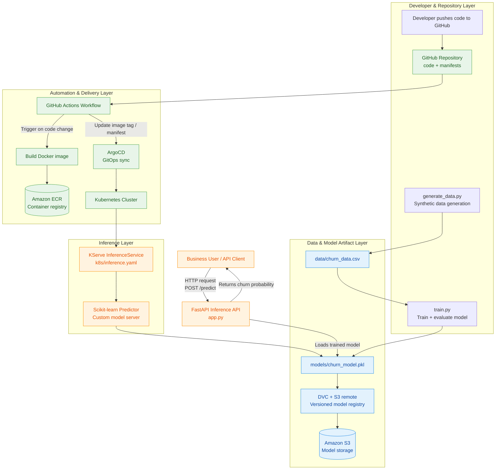

# Churn Model MLOps Demo

This project is a practical MLOps demonstration for building, versioning, deploying, and serving a customer churn prediction model in a production-like workflow. It shows how a simple machine learning use case can evolve into a repeatable pipeline using modern DevOps and ML operations best practices such as automated training, model artifact storage, containerization, deployment automation, and real-time inference serving.

## Project Description

The goal of this repository is to predict whether a customer is likely to churn based on features such as age, tenure, monthly charges, total charges, and support calls. The solution uses a synthetic telecom dataset to simulate a realistic customer retention problem and demonstrates how an ML model can be trained, tracked, and deployed using an end-to-end MLOps pipeline.

This project is intended for learning and demonstration purposes, but it follows patterns commonly used in production environments:

- Data generation and preprocessing
- Model training and evaluation
- Model artifact versioning
- Cloud storage for trained models
- CI/CD workflow automation
- Kubernetes-based deployment
- Real-time prediction API
- GitOps-driven delivery with ArgoCD

## Tools and Technologies Used

- Python 3.11
- Pandas for data processing
- NumPy for synthetic data and array operations
- scikit-learn for machine learning model training and evaluation
- FastAPI for the prediction API
- Uvicorn as the ASGI server
- Pickle for saving and loading the trained model
- DVC for data/model version control
- AWS S3 for model artifact storage
- Boto3 for AWS integration
- Docker for containerization
- GitHub Actions for CI/CD automation
- Kubernetes (KIND for local cluster testing)
- KServe for inference serving on Kubernetes
- ArgoCD for GitOps-based deployment
- AWS ECR for container registry

## What Does This Model Do?

**Real-World Example:**

Imagine you run a telecom company with thousands of customers. Some customers are happy and stay for years, while others leave (churn) after a few months. This model predicts which customers are likely to leave.

**Example Customer:**
- **Sarah** is 45 years old
- Been a customer for 24 months
- Pays $79.99/month
- Total spent: $1,920
- Called customer support 3 times this month

**Model Prediction:**
```json
{
  "churn": 1,
  "churn_probability": 0.73
}
```

**Translation:** Sarah has a **73% chance of canceling her subscription**. Why? She's calling support frequently (unhappy) and paying relatively high fees. Your business can now:
- Offer her a discount
- Reach out with personalized support
- Prevent losing her before she leaves

**The model looks at patterns** like:
- High monthly charges → More likely to churn
- More support calls → Customer is frustrated
- Low tenure → Haven't built loyalty yet

This helps businesses **save customers proactively** instead of reacting after they've already left!

## Project Structure

```
churn-model/
├── generate_data.py          # Generate synthetic churn dataset
├── train.py                   # Train the model
├── app.py                     # FastAPI inference server
├── requirements.txt           # Python dependencies
├── Dockerfile                 # Container image
├── .dvc/config               # DVC configuration
├── models/
│   └── churn_model.pkl.dvc   # DVC metadata for model
├── k8s/
│   ├── deployment.yaml       # Kubernetes deployment
│   └── inference.yaml        # KServe inference service
├── .github/workflows/
│   └── mlops-pipeline.yaml   # GitHub Actions CI/CD
└── argocd/
    └── application.yaml      # ArgoCD application
```

## Detailed Architecture Diagram

This repository follows a full MLOps lifecycle for a churn prediction model: synthetic data generation, model training, artifact versioning, CI/CD automation, containerization, and Kubernetes deployment for online inference.



### Flow Explanation

1. A developer updates the code or training pipeline in GitHub.
2. `generate_data.py` creates a synthetic churn dataset and saves it under `data/`.
3. `train.py` reads the data, trains a `RandomForestClassifier`, evaluates it, and saves the model as `models/churn_model.pkl`.
4. DVC tracks the model and pushes the artifact to an S3-backed remote for versioned storage.
5. GitHub Actions automates the model training, packaging, and deployment workflow.
6. Docker builds an image for the model-serving environment and pushes it to ECR.
7. ArgoCD watches deployment manifests and syncs updates into the Kubernetes cluster.
8. KServe exposes the model through an `InferenceService`, which serves predictions over a REST endpoint.
9. The FastAPI app loads the saved model and exposes a business-friendly `/predict` endpoint for real-time scoring.

## MLOps Pipeline Steps

### 1. Initial Setup

```bash
# Install dependencies
pip install -r requirements.txt

# Generate dataset
python generate_data.py

# Train model
python train.py

# Test API locally
python app.py
# Visit http://localhost:8000/docs
```

### 2. DVC Setup (Data Version Control)

```bash
# Initialize DVC
dvc init

# Configure S3 remote
dvc remote add -d myremote s3://my-bucket/churn-model

# Track model with DVC
dvc add models/churn_model.pkl

# Push to S3
dvc push

# Commit DVC metadata
git add models/churn_model.pkl.dvc .dvc/ .gitignore
git commit -m "Track model with DVC"
```

### 3. Push Model to S3

After training the model and setting up DVC:

```bash
# Configure AWS credentials (if not already done)
export AWS_ACCESS_KEY_ID=your-key
export AWS_SECRET_ACCESS_KEY=your-secret
export AWS_DEFAULT_REGION=us-east-1

# Create S3 bucket
aws s3 mb s3://my-bucket

# Push model to S3 using DVC
dvc push

# Verify model is in S3
aws s3 ls s3://my-bucket/churn-model/models/ --recursive
```

The model will be stored in S3 at: `s3://my-bucket/churn-model/models/churn_model.pkl`

### 4. S3 Configuration

**Note:** This section is already covered in Step 3. S3 is used by DVC to store models.

### 5. Kubernetes with KIND

```bash
# Create KIND cluster
kind create cluster --name churn-model
```

### 6. KServe Setup

```bash
# Install KServe
kubectl apply -f https://github.com/kserve/kserve/releases/download/v0.11.0/kserve.yaml

# Create namespace, ServiceAccount and S3 secret for KServe
# Update k8s/serviceaccount.yaml with your AWS credentials first
kubectl apply -f k8s/serviceaccount.yaml

# Deploy inference service
kubectl apply -f k8s/inference.yaml

# Check inference service
kubectl get inferenceservice -n churn-model

# Wait for it to be ready
kubectl get inferenceservice churn-predictor -n churn-model -w
```

**Important:** Before deploying, update `k8s/serviceaccount.yaml` with your actual AWS credentials.

### 7. Test KServe Inference

```bash
# Get the inference service URL
INGRESS_HOST=$(kubectl get inferenceservice churn-predictor -n churn-model -o jsonpath='{.status.url}' | cut -d/ -f3)
SERVICE_HOSTNAME=$(kubectl get inferenceservice churn-predictor -n churn-model -o jsonpath='{.status.url}' | cut -d/ -f3)

# For local KIND cluster, port-forward
kubectl port-forward -n churn-model service/churn-predictor-predictor-default 8080:80

# Test prediction with curl
# Note: sklearn models expect data as arrays, not named features
# Order: age, tenure_months, monthly_charges, total_charges, num_support_calls
curl -X POST http://localhost:8080/v1/models/churn-predictor:predict \
  -H "Content-Type: application/json" \
  -d '{
    "instances": [
      [45, 24, 79.99, 1920.00, 3]
    ]
  }'
```

Expected response:
```json
{
  "predictions": [1]
}
```

### 8. GitHub Actions

**Required Secrets:**
- `AWS_ACCESS_KEY_ID`
- `AWS_SECRET_ACCESS_KEY`

**Pipeline Flow:**
1. Checkout code
2. Generate dataset
3. Train model
4. Push model to S3 via DVC
5. Build Docker image
6. Push image to ECR
7. Update `inference.yaml` with new image tag
8. Commit changes (triggers ArgoCD)

### 9. ArgoCD (GitOps)

```bash
# Install ArgoCD
kubectl create namespace argocd
kubectl apply -n argocd -f https://raw.githubusercontent.com/argoproj/argo-cd/stable/manifests/install.yaml

# Deploy application
kubectl apply -f argocd/application.yaml

# Access ArgoCD UI
kubectl port-forward svc/argocd-server -n argocd 8080:443

# Get admin password
kubectl -n argocd get secret argocd-initial-admin-secret -o jsonpath="{.data.password}" | base64 -d
```

## Complete MLOps Workflow

1. **Developer pushes code** → GitHub
2. **GitHub Actions triggered:**
   - Trains model
   - Pushes model to S3 (DVC)
   - Builds Docker image
   - Pushes to ECR
   - Updates `inference.yaml`
3. **ArgoCD detects change** in `inference.yaml`
4. **ArgoCD syncs** → Deploys to Kubernetes
5. **KServe serves** the new model version

## API Usage

```bash
curl -X POST http://localhost:8000/predict \
  -H "Content-Type: application/json" \
  -d '{
    "age": 45,
    "tenure_months": 24,
    "monthly_charges": 79.99,
    "total_charges": 1920.00,
    "num_support_calls": 3
  }'
```

Response:
```json
{
  "churn": 1,
  "churn_probability": 0.73
}
```

## Key Components

- **DVC**: Version control for data and models in S3
- **S3**: Remote storage for models and data
- **KServe**: Serverless ML inference on Kubernetes
- **KIND**: Local Kubernetes for testing
- **GitHub Actions**: CI/CD automation
- **ArgoCD**: GitOps continuous deployment

## Notes

- Replace `your-registry` in YAML files with your actual container registry
- Replace `your-org` with your GitHub organization
- Replace `my-bucket` with your S3 bucket name
- This is a minimal demo - production setups require monitoring, logging, and security hardening
